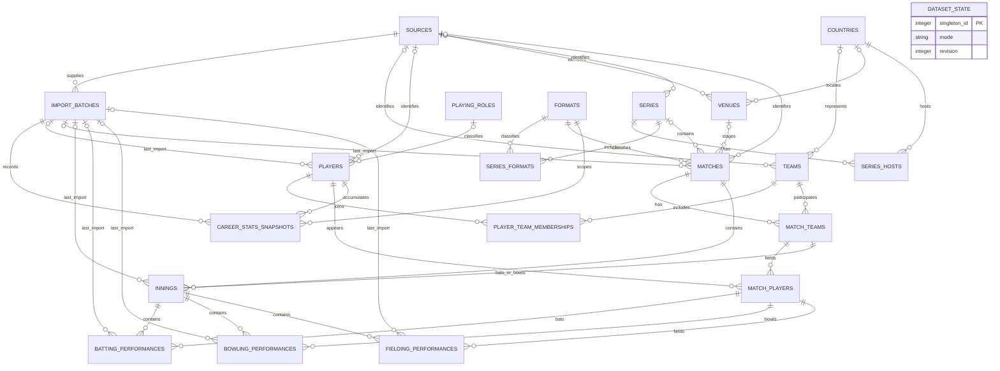

# Phase 4 Database design and ER diagram

This design provides relational storage for cricket reference data, matches, innings, player performances and provider career snapshots. The executable table definitions are in sql/schema.sql. They use the SQLite dialect selected for the local baseline; PostgreSQL and MySQL adaptations remain unimplemented and unverified.

Phase 4 designs and validates the schema in an isolated in-memory database. It does not create a persistent application database, import real cricket data, implement CRUD or solve the 25 analytical questions. Those activities remain in their agreed phases.

## 1 Concepts before the schema

A table stores one kind of record at a defined grain. A primary key identifies that record; a foreign key requires a referenced record to exist. A unique constraint prevents duplicate identities, while a CHECK constraint limits a value or combination of values. An index speeds selected reads at the cost of storage and write work.

Grain matters especially in cricket: one match can have several innings, and a player's career snapshot is not the same record as that player's batting performance in one innings. Joining different grains without care duplicates totals.

## 2 Entities and keys

| Entity | One row represents | Primary key | Important foreign keys and uniqueness |
| --- | --- | --- | --- |
| sources | A named API, manual or sample source | source_id | Unique name |
| import_batches | A fetch/import unit with time and completeness | batch_id | source_id → sources |
| countries | A country used for representation/location | country_id | Unique name and optional code |
| formats | A competition format and level | format_id | Unique code; family distinguishes TEST/ODI/T20/OTHER |
| playing_roles | A normalized player role | role_id | Unique name |
| teams | A cricket team | team_id | country_id; unique source_id + external_id |
| players | A player identity and current profile | player_id | role_id, source_id, last_batch_id; unique source identity |
| player_team_memberships | An evidenced membership interval | membership_id | player_id, team_id; unique player/team/start |
| venues | A venue and known location/capacity | venue_id | country_id, source_id; unique source identity |
| series | A competition series | series_id | source_id; unique source identity |
| series_hosts | A series-host-country association | series_id + country_id | Both parent records |
| series_formats | A format included in a series | series_id + format_id | Both parent records |
| matches | A match, status, toss and result | match_id | series, format, venue, source, batch; winner/toss must be participants |
| match_teams | One of a match's two team slots | match_id + team_id | Match and team; unique match/slot |
| match_players | A known player on a team in a match | match_id + player_id | Player and match-team; one team per player per match |
| innings | One innings, including marked super overs | innings_id | Match and batting/bowling match-teams; unique match/innings number |
| batting_performances | One player's batting in one innings | innings_id + player_id | Matching innings batting team and match-player; unique innings/position |
| bowling_performances | One player's bowling in one innings | innings_id + player_id | Matching innings bowling team and match-player |
| fielding_performances | One player's fielding totals in one innings | innings_id + player_id | Matching innings bowling team and match-player |
| career_stats_snapshots | One player/format's career aggregate in a fetch | snapshot_id | Player, format, batch; unique player/format/batch |
| dataset_state | The database's mode and cache revision | singleton_id = 1 | One row maximum; initialized in Phase 8 |

All foreign-key columns and value constraints appear explicitly in the SQL file. No real source, role or format records are seeded in this phase. Use canonical roles such as Batsman, Bowler, All-rounder and Wicket-keeper during later setup.

## 3 ER diagram

The diagram shows the main relationships; the SQL file is authoritative for composite keys and checks. A parent can have zero or many children. Optional foreign keys allow unknown venues, countries or series without invented records.

For example: India and Australia are team records; a match links them through two match_teams rows; each innings links its batting and bowling teams; a performance must reference a player on the correct team in that match. Historical match-team identity does not depend on the player's current profile or later membership.

## 4 Relationships and constraint design

### Match participants, toss and winner

match_teams permits only slots 1 and 2 and prevents duplicate slots or teams within a match. This enforces at most two teams. The ingestion service must require exactly two before calling a match complete enough for analytical use.

matches references match_teams for the toss winner and winner. This circular dependency is intentional: create the match initially with no toss/winner and result_type pending, insert both match_teams rows, then update the result in the same transaction. Never disable foreign keys to import a finished match.

A winning result needs a winner. Tie, draw, pending and no-result rows cannot have a winner. Margin amount and unit must both be known or both absent; unknown margins are allowed even for a win, including unusual result methods. The original status_text retains provider wording. A tie resolved by a super over can have a winning result with no conventional runs/wickets margin.

### Match-player and innings consistency

Composite foreign keys ensure a batting record belongs to the batting team in that same innings and match. Bowling and fielding records must belong to the bowling team. Players appearing only as substitutes can still be represented without falsely labeling them confirmed playing-XI members.

The repeated match_id and team_id in performance tables enable these declarative checks. They are deliberate, constrained redundancy: the database cannot accept inconsistent values. Unique parent combinations exist to support those composite references.

### Numeric and missing-data constraints

Runs, balls, capacities and career counts cannot be negative. Wickets in a bowling performance or innings are limited to 0–10. Positions are 1–11 when known. NULL represents unknown, including unknown dismissal status; zero means a known zero. Optional measures do not default to zero.

SQLite CHECK treats NULL differently from a required field, so NOT NULL is used on identities and required controls. The local schema uses integer flags restricted to 0/1. Application validation must also enforce integer types for counts because SQLite's ordinary type affinity is not a complete type validator.

### Dates and intervals

Use canonical UTC timestamp strings in the form YYYY-MM-DDTHH:MM:SSZ, and date strings YYYY-MM-DD. Services validate actual calendar values and normalize precision before persistence; the SQL file does not attempt comprehensive date parsing. Lexical interval checks assume that normalization.

Membership valid_from is the start of an evidenced interval, not an invented career debut. If an API only establishes current representation, use the observation date as that interval's start and document the limited coverage. Unknown historical selection is not inferred from it. Reject overlapping intervals for the same player/team in the service. A player may represent a national side and a franchise concurrently.

### Service rules beyond SQL constraints

The service must enforce: import batch/source consistency; two teams for an analytically usable match; source kind versus data mode; source identity belonging to the selected API; chronological update ordering; non-overlapping duplicate membership intervals; correspondence between series_formats and the match format where series coverage is known; coherent status/result transitions; valid dates; and valid cricket totals where coverage supports checking them.

A row-level CHECK cannot enforce all cross-row and external-data rules. Do not claim the DDL alone implements ingestion correctness or authorization.

## 5 Normalization explanation

**First normal form:** each column contains one value. Teams, formats and host countries are related through rows, not comma-separated lists. Series can span several formats and host countries without duplicated series descriptions.

**Second normal form:** attributes describe their whole key. A batting performance's runs belong to its innings/player pair. Player name belongs to players, not to every batting row; venue details belong to venues, not matches.

**Third normal form:** avoid storing lookup descriptions through another non-key attribute. Country names, role names and format definitions live in their own tables. Team membership and match appearance are distinct relationships rather than one mutable player team column.

The core aims for third normal form with explicit exceptions: composite-FK copies of match/team IDs are constrained redundancy, and provider-reported career averages are retained alongside their totals as source evidence. Those reported averages are not silently treated as recalculated truth. Updated timestamps and revision/version controls are operational metadata.

Derived innings strike rate and economy are not stored in performance rows. Compute them from runs/balls with zero-denominator handling during later query lessons. Career snapshots may retain reported ratios when the provider does not expose their denominators; label which measure is used.

## 6 Ownership and CRUD policy

Use row-level ownership for players and batting, bowling and fielding performances:

| ownership | Meaning | Refresh behavior |
| --- | --- | --- |
| api | Provider-owned normalized record | May update from a newer valid provider snapshot |
| manual | Locally created record | Not overwritten or matched by name during API imports |
| override | Operator-edited provider record | Skip provider updates until the override is explicitly released |

Editing an API-owned record changes ownership to override while retaining its source identity and last imported batch. It locks the entire row, not individual fields. The retained last_batch_id is provenance only; an overridden result must be labeled manually corrected rather than purely API-sourced. The interface must explain that provider updates for that record pause; this simple policy favors understandable corrections over a more complex per-field merge system.

Delete operations set is_deleted = 1. API-sourced deleted records also become override tombstones so a later refresh cannot recreate them. All normal reads and analytics must filter tombstones, including the joined player record. A logically deleted player's historical data remains stored but is excluded from normal outputs. This is a documented reversible deletion policy, not physical erasure.

The unique innings/position constraint also includes tombstones. Restore or edit the existing record rather than creating a second row for that same player or position. Moving a position to another player requires an explicit transaction that clears the old position first. No silent duplicate positions are permitted.

Resetting an override is a separate deliberate action: clear its tombstone if restoring it, change ownership to api, and fetch current provider data. Do not call an old retained value a fresh API result. This phase defines the policy; service enforcement and UI are pending.

Use version as an optimistic concurrency token. Updates require the expected current version and increment it on success; zero updated rows means stale or missing data. DDL checks positive versions but does not automatically implement the update rule. Advance dataset_state.revision in the same transaction as each successful content change.

## 7 Deletion rules and provenance

All foreign keys use ON DELETE RESTRICT. Removing an innings, team or player physically cannot silently cascade away analytical history. Normal player and performance CRUD uses the tombstone policy above. Physical deletion, if ever needed for maintenance, requires a separate ordered cleanup with explicit review of dependencies; it is not the standard application action.

source_id + external_id uniquely identifies provider reference entities. Both must be absent or present together. Names are deliberately not unique because people, venues and teams can share or change names. An importer may link aliases later, but must not merge players by spelling alone.

last_batch_id identifies the latest applied provider snapshot for a mutable row. Override timestamps describe the manual change; last_batch_id remains the previous provider origin. A complete audit of every prior field value is not provided and remains a bonus enhancement.

A batch records capability, fetch time, optional provider update time and completeness. Save a pending batch, apply one match import transaction, mark committed and advance the revision atomically. On rollback, record failed status separately without claiming data was imported. Do not mark a whole response complete merely because it returned HTTP success. Missing fields in partial responses do not erase known data.

Career snapshots are append-only at player/format/batch grain. The latest eligible committed snapshot is selected deliberately; never add snapshots together. Combine batting, bowling and fielding capabilities into one normalized snapshot only when their scopes align; otherwise preserve separate batch snapshots and document field availability. A snapshot with unknown wickets cannot satisfy a complete bowling ranking.

## 8 Index plan

Primary keys and unique constraints already provide identity lookup paths. The DDL adds these candidates; verify their usefulness against real query plans later.

| Index group | Intended access |
| --- | --- |
| Batches by source/fetch time | Freshness and career-snapshot selection |
| Players by role | Role counts and all-rounder filtering |
| Membership by team/date and player/date | Representation at an analysis date |
| Venues by country | Home/away grouping and location lookup |
| Series by start date | Series starting in 2024 |
| Matches by start, status/completion, format/start | Recent matches, completed matches and format history |
| Matches by venue, series and winner | Venue analysis, series details and team wins |
| Match teams and players by team/player then match | Head-to-head and participation history |
| Performance tables by player/match | Player form, consistency and career evolution |
| Career snapshots by format/player/batch | Format-level leaderboards and snapshot lookup |

Do not index every column automatically. More indexes cost writes. Query plans, dataset size and actual filters determine adjustments in later phases.

## 9 Data support for the 25 questions

| Questions | Designed data path |
| --- | --- |
| Q01, Q06 | Players → roles; representation via memberships → international teams → countries |
| Q02, Q05, Q10 | Matches → match teams → teams; venue and result |
| Q03, Q07, Q09, Q11 | Format-level career snapshots for career scope; Q07 can use stored innings scores only with explicit dataset scope |
| Q04 | Venues, countries and capacity |
| Q08 | Series → hosts/countries and formats |
| Q12 | Match team country versus venue country and result |
| Q13, Q24 | Batting positions in the same innings; combined-score proxy |
| Q14, Q18 | Bowling → innings → match → venue/format, legal balls and conceded runs |
| Q15, Q16, Q19, Q20 | Batting and match participation, dated matches, dismissals and typed margins |
| Q17 | Match toss decision, toss winner and match winner |
| Q21 | Aligned player/format career snapshots, or a clearly scoped match-history aggregation; never mix them |
| Q22 | Match teams, venues, dated results and actual innings order |
| Q23, Q25 | Ordered batting performances → innings → dated matches |

series_hosts and series_formats can produce multiple rows for a multi-host/multi-format series. Later query lessons must choose a clear display grain rather than multiply planned match counts. Super-over records are stored but excluded from ordinary batting/bowling totals unless a query explicitly includes them.

Q01 initially means representation as of the chosen analysis date, using evidenced membership and international team classification. Nationality is not assumed equivalent to representation. Other unresolved statistical definitions from Phase 2 stay pending their SQL lesson; the schema stores the ingredients without inventing form thresholds.

## 10 SQL usage and verification boundary

sql/schema.sql includes all 21 CREATE TABLE statements, 18 explicit CREATE INDEX statements and transaction boundaries. It is a baseline creation script for an empty SQLite database, not an idempotent migration system. Re-running it against the same populated database should fail rather than silently claim a migration occurred.

Enable foreign-key enforcement on every SQLite connection before starting transactions. The script creates no persistent database itself; the Phase 4 validation uses only an isolated in-memory connection. Actual initialization, seed data and database utilities remain Phase 8 work.

PostgreSQL will require identity-column and type/date adaptations; MySQL will require its corresponding identity, type, index and constraint review. Foreign-key creation order for the matches/match_teams cycle needs engine-specific migration handling. SQLite PRAGMA statements are not portable. No compatibility claim follows from SQLite validation alone.

## Phase completion

**What we completed:** defined 21 entities and their grains; documented keys, relationships, normalization, index candidates, missing-data rules, deletion behavior and provider/manual ownership; provided the ER diagram and executable SQLite DDL.

**Files created:** documentation/04_database_design.md and sql/schema.sql. Verification evidence is recorded in documentation/04_schema_validation.md. The Phase 2 checklist now records design completion, while database implementation remains pending.

**Concepts learned:** primary and composite keys, foreign keys, cardinality, normalization, constrained redundancy, snapshots versus events, soft deletion, optimistic concurrency and index tradeoffs.

**Common mistakes to avoid:** treating 4.2 overs as a decimal; averaging averages; counting innings as matches; adding career snapshots together; inventing missing data; merging identities by name; and assuming schema checks enforce service-level access or ownership rules.

**Next phase preview:** Phase 5 verifies the actual Cricbuzz API provider, endpoints, authentication, quotas, pagination, JSON fields and table mappings. Provider gaps may require documented schema refinements. The supplied mentoring prompt requires confirmation before proceeding.
